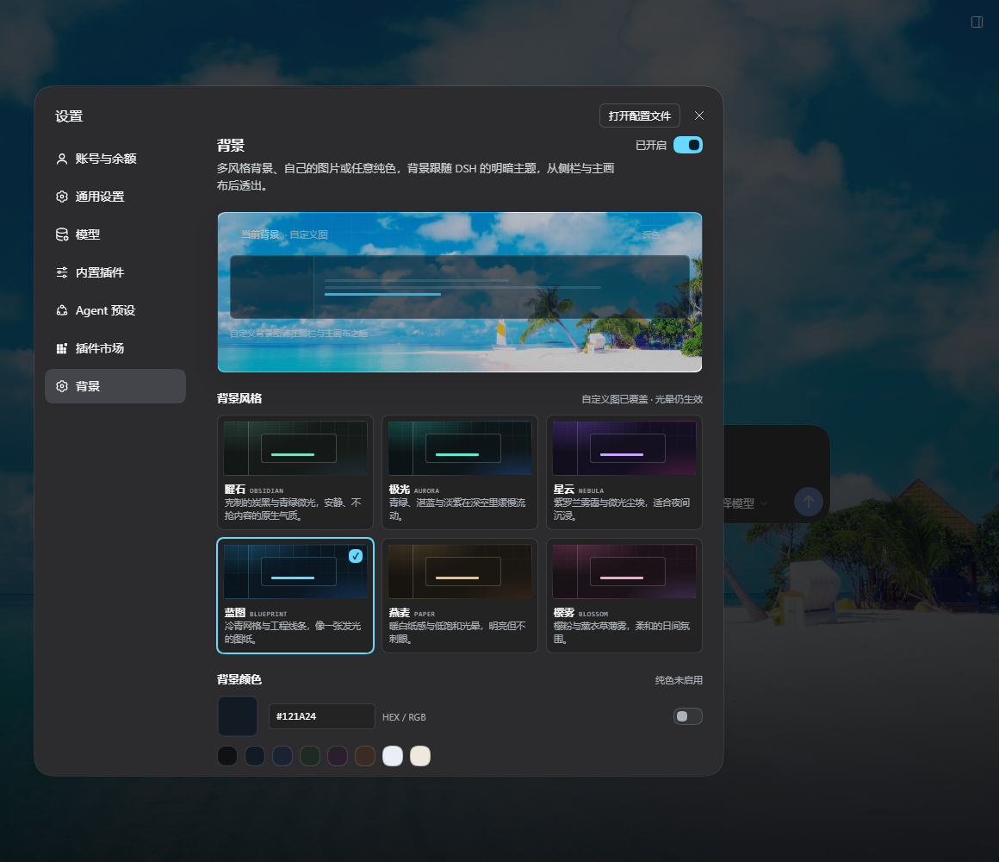
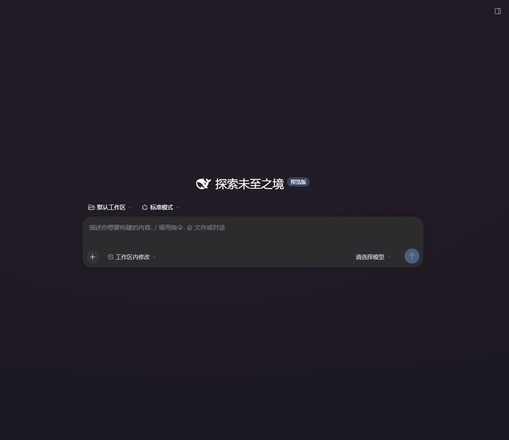
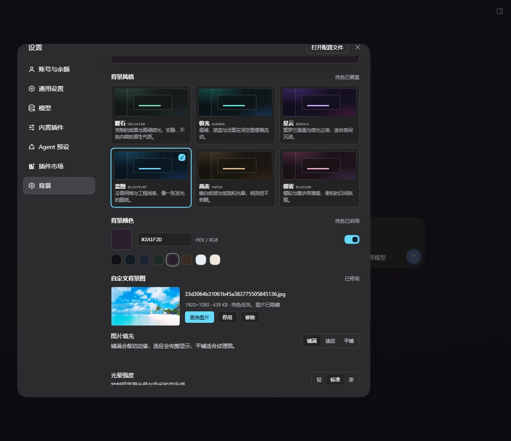
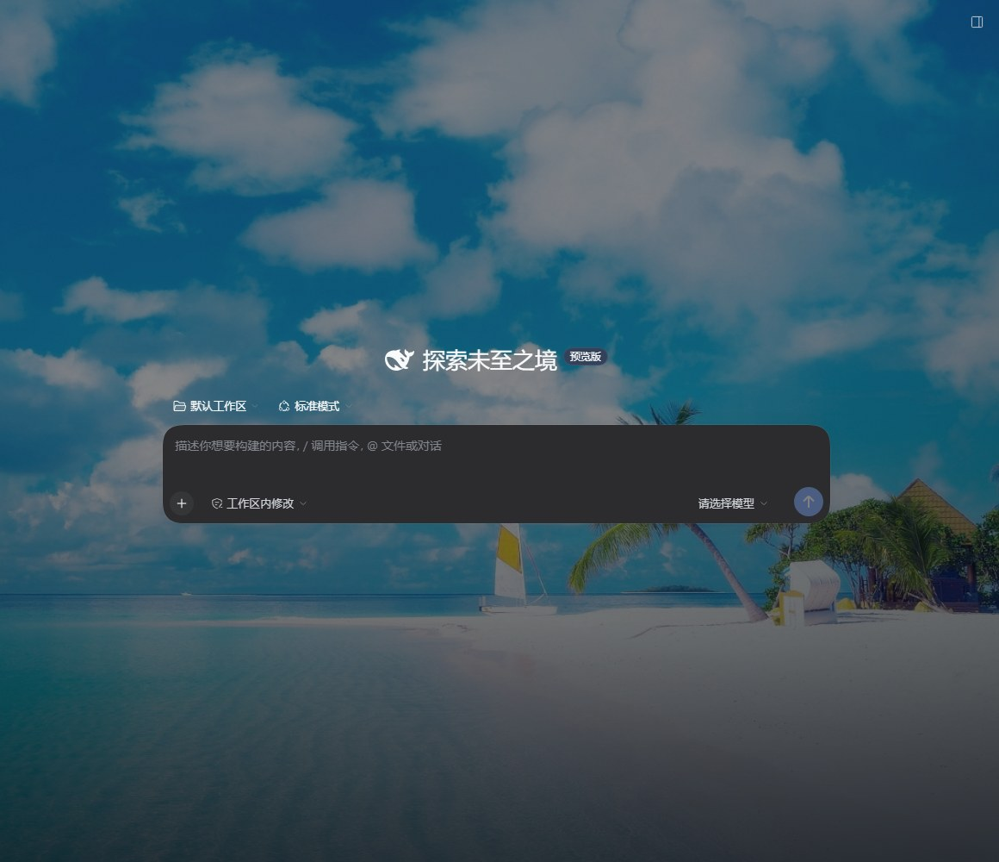

# dsh-background-studio

DeepSeek Harness 的多风格背景插件：6 套可切换背景、一张自己的图片，或任意纯色，注册为设置里的独立「背景」页，跟随 DSH 的浅色 / 深色主题。



## 效果

- **6 套背景**：曜石、极光、星云、蓝图、燕麦、樱雾
- **自定义背景图**：选择或拖入本地图片，支持铺满 / 适应 / 平铺，可随时停用但保留图片
- **纯色背景**：取色器、HEX 输入和 8 个快捷色；开启后盖住风格背景与图片，关掉即恢复。选择任一风格或重新启用图片会自动退出纯色模式
- 每套配色都有深色与浅色两版，随 DSH 外观模式自动切换
- 光晕强度：轻 / 标准 / 浓
- **背景不透明度**：0–100% 滑块，100% 时背景完全可见，调低会逐渐淡出，0% 回到 DSH 原生外观。设置页顶部的预览会同步变淡，拖动时立刻能看到效果
- 「面板透出」开启时，侧栏、主画布和 Windows 标题栏会透出背景：侧栏不再叠半透明主题色，也没有毛玻璃模糊，直接显示底图；关闭后回到实色面板
- 背景层由渐变光晕、网格、噪点、缓慢漂移组成，`prefers-reduced-motion` 下停止动画
- 不替换原生设置页，不修改 DSH 组件，只在 `html` 上挂 `data-dsh-qbg*` 属性并覆盖少量主题 token






> **从 0.2.0 升级**：旧版「背景透明度」的方向是反的（100% = 完全隐去），所以 85% 这类取值会让背景只剩百分之几、看起来像没生效。0.2.1 改成「背景不透明度」，旧配置文件里的 `transparency` 会在读取时视为 `opacity: 100`，即升级后先完全显示背景。

## 设置存在哪里

桌面版每次启动都会换一个本地端口，页面的 origin 随之改变，`localStorage` / IndexedDB 在那个 origin 下等于被清空。所以设置和图片都存在宿主侧：

```
~/.dsh/background-studio/
  settings.json     主题、纯色、不透明度、面板透出、填充方式等
  image.json        图片元数据（名称、尺寸、类型、版本号）
  background.<ext>  图片本体
```

页面启动时先读本地镜像立即上色，再向 `/dsh-background-studio/api/state` 拉取权威值并覆盖。图片超过 2560px 或 1.2 MB 会先在浏览器里压缩成 WebP（失败回落 JPEG），再交给宿主写入磁盘；图片只留在本机，不发往任何网络服务。

## 安装

```powershell
dsh plugin --profile desktop add github:SoulZhou/dsh-background-studio
```

这条命令会同时把包写进 profile 的 `dependencies` 和（因为声明了 `dsh.bundle.patch`）`dsh.profile.bundles`。

本地开发时也可以直接链接源码目录：

```powershell
dsh plugin --profile desktop add "D:\Documents\deepseek-harness\default-workspace\dsh-background-studio"
```

安装后需要**完全退出并重新打开 DeepSeek Harness**：桌面 profile 由 Electron 管理，运行中的窗口不会热加载新的 bundle，宿主端的 API 路由也要随进程重启才注册。重启后打开 **设置 → 背景**。

从其他机器安装可以先用打包文件：

```powershell
pnpm pack
dsh plugin --profile desktop add .\dsh-background-studio-0.3.0.tgz
```

## 卸载

```powershell
dsh plugin --profile desktop remove dsh-background-studio
```

卸载后 `~/.dsh/background-studio/` 会保留，可手动删除。

## 实现

`client.js` 是手写的 DSH ModuleLoader bundle，无需构建，只依赖宿主已有的 React：

1. 在 `document.body` 首位插入 `#dsh-qbg-layer`（纯色 → 自定义图 → 压暗罩 → 光晕 → 网格 → 噪点 → 暗角），并注入样式
2. 把当前配色与纯色写到 `document.documentElement` 的 `--qbg-*` 变量上；纯色开启时隐藏光晕、网格与压暗罩，只保留轻微暗角
3. 不透明度直接写 `--qbg-layer-opacity`（`opacity / 100`），配合 `html` 上的 `--qbg-surface` 露出 DSH 原生底色；同时按比例降低饱和度
4. 在 `html[data-dsh-qbg="on"][data-dsh-qbg-glass="on"]` 下把 `--dsw-alias-bg-base` 与 `--dsw-specific-sidebar-fill` 都置为透明，并强制 `[class*="sidebarCol"]` 透明，让侧栏和主画布直接显示底图
5. 用 `ctx.slots.register({ name: 'settings.section', ... })` 注册「背景」页

`index.js` 是宿主端，通过 `ctx.inject(['webServer'])` 注册三条同源路由：

| 方法 | 路径 | 作用 |
| --- | --- | --- |
| `GET` | `/dsh-background-studio/api/state` | 读取设置与图片元数据 |
| `PUT` | `/dsh-background-studio/api/settings` | 保存设置（白名单字段） |
| `GET/POST/DELETE` | `/dsh-background-studio/api/image` | 读取 / 上传 / 删除图片 |

图片按文件头嗅探类型，只接受 JPEG / PNG / WebP / GIF，单张上限 24 MB。

`apply()` 返回的 disposer 会移除背景层、样式、文档属性和 `--qbg-*` 变量，宿主路由也会随插件上下文一起注销。
